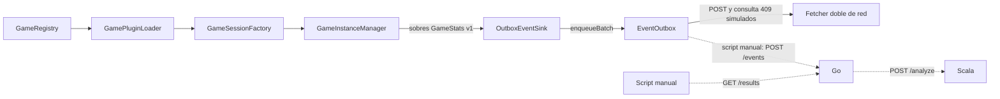

# Fase 3A — EventSink y EventOutbox

Se conecta el administrador SDK con el EventOutbox existente mediante
OutboxEventSink. La composición se verifica con **EventOutbox real y fetcher
simulado**, sin sockets ni servicios. Se prepara un script manual para Go/Scala;
su ejecución real no forma parte de esta evidencia. HTTP/frontend y los tres
juegos históricos no cambian ni importan el nuevo ensamblador.

## Flujo y responsabilidades



El manager mantiene identidad, versiones, ciclo de vida y confirmaciones. El
GameEventAdapter sigue construyendo los sobres y validando permisos de jugadores
y tipos reservados. OutboxEventSink adapta aceptación local, sin estado de juego,
cola propia, scheduler o reintentos. EventOutbox conserva colas y bombeo HTTP por
matchId, entrega y comprobación de duplicados. Go organiza/valida y Scala calcula
resultados bajo demanda; ninguna métrica se calcula en el sink o en el manager.

El ensamblador `test/helpers/sdk-transport.mjs` registra exclusivamente el fixture
`test/fixtures/sdk-transport/racing/`, autoriza su ID, carga/prepara sesiones y
construye manager → sink → outbox. Es infraestructura de prueba compartida con el
script manual; no se importa desde server/index.mjs ni se instala en plugins/.
El fixture produce eventos sintéticos LAP_COMPLETED: no es Circuito migrado, un
simulador físico ni un cuarto videojuego entregable. Su ID racing permite consultar
el perfil analítico ya existente sin cambiar GameStats.

## Interfaz y garantía de aceptación

```js
outbox.enqueueBatch(events); // void, síncrono
const sink = new OutboxEventSink(outbox);
sink.accept(event);          // enqueueBatch([event])
sink.acceptBatch(events);    // enqueueBatch(events)
```

enqueueBatch acepta **1–32 eventos** del mismo `(gameId, matchId)`, en el orden
recibido. Valida todos antes de tocar streams o iniciar fetch:

- Arreglo denso JSON, sin propiedades extra ni accesores; sobres objeto sin
  símbolos/accesores/campos ocultos. Cada campo se copia con las utilidades JSON
  existentes (incluido data, con presupuesto de profundidad 64 por campo).
- schemaVersion exacto 1; eventId, gameId, matchId y type strings no blancos;
  timestamp RFC3339 con fecha válida y zona; data objeto JSON.
- gameVersion/playerId opcionales, strings cuando estén presentes. Como en Go,
  se admiten strings opcionales vacíos. Campos extra del sobre deben ser JSON;
  Go puede descartarlos. El productor SDK sigue generando solo su sobre normativo.
- Máximo 1 MiB UTF-8 por evento serializado para POST. eventIds distintos dentro
  del lote; todos los miembros comparten identidad de partida.

Se prepara privadamente el lote completo, con copias profundamente congeladas.
Para un stream existente se construye el siguiente array preservando el prefijo
pendiente y se publica mediante **una asignación** a stream.queue; para uno nuevo,
mediante una inserción en streams. Solo después se llama al pump existente. No se
implementa como un bucle de enqueue y el fetcher nunca observa un lote a medio
insertar. No hay un segundo almacenamiento persistente de la cola o de la partida.

Un rechazo de validación arroja INVALID_EVENT_BATCH sin insertar/enviar prefijo
ni cambiar el stream existente. Un Outbox detenido rechaza la nueva ruta con
OUTBOX_STOPPED. El adaptador usa la misma validación para aceptación individual:
no retiene ni transmite un evento rechazado. Resolver/retornar significa que el
lote completo quedó en memoria local, **no que Go haya contestado**.

El constructor de OutboxEventSink exige EventOutbox real y conserva su referencia
privada. Se inyecta solo en el host; no se entrega a plugins o clientes.

## Compatibilidad histórica

enqueue, pump, status, flush y stop conservan su implementación y comportamiento.
En particular, enqueue histórico no añade validación y todavía puede acumular
eventos después de stop. La ruta nueva de lotes es más estricta y los rechaza.
El nuevo método importa únicamente utilidades JSON puras del SDK; no carga juegos,
no crea sesiones y no inicia servicios al importar el Outbox.

Las colas históricas se indexan por matchId, sin cambiar su clave a un par. Los
UUID globalmente nuevos del SDK y de los juegos existentes cumplen esa premisa.
Productores ajenos no deben reutilizar un matchId entre juegos esperando colas
independientes: el modelo remoto de Go sí utiliza `(gameId, matchId)`.

## Orden, fallos y límites reales

El pump procesa una sola cabecera por partida, en orden de inserción. Un fallo
temporal conserva el mismo sobre/eventId y reintenta con la espera creciente
existente. Otros streams pueden seguir avanzando. status conserva sus campos:
pending incluye la cabecera en vuelo, delivered cuenta entradas reconocidas como
entregadas, y error describe el último fallo pendiente. flush espera todas las
colas hasta su timeout; stop impide continuar el bombeo, no borra colas ni cancela
automáticamente una petición que ya esté en vuelo.

Un 409 solo se trata como entregado si GET /matches/{gameId}/{matchId} devuelve
ese mismo eventId en eventIds. Otro ID o consulta fallida mantiene la cabecera
pendiente. La comprobación histórica es por ID, no compara el cuerpo completo.
El SDK genera UUID y copias inmutables para conservar el cuerpo de los reintentos.

La prueba de respuesta perdida hace que el receptor acepte un evento antes de
simular el fallo de red. El siguiente POST obtiene 409 y la inspección confirma
el ID: el receptor conserva un único evento. Esto demuestra ese caso simulado,
no una garantía universal de entrega exactamente una vez. Si la recepción o la
consulta son ambiguas, se conserva pendiente y se vuelve a intentar.

**La atomicidad es solo local, en una ejecución síncrona del proceso.** Los
miembros del lote viajan en POST individuales, no en una transacción Go. Un
prefijo puede llegar a Go y un evento posterior fallar. El estado SDK ya confirmado
localmente no se revierte ni certifica completitud remota. No hay persistencia,
atomicidad frente a caída, recuperación durable ni reconciliación tras reiniciar Go.

El Outbox valida sobres, no el historial remoto, las reglas del juego o el
contenido analítico de Scala. Go mantiene sus límites: POST 1 MiB, hasta 10 000
eventos y 8 MiB por snapshot, con reserva para cierre. Un lote local válido puede
superar capacidad acumulada o incumplir ciclo de vida remoto. El comportamiento
histórico reintenta también errores permanentes como 413; no hay dead letter,
descarte automático o división de partidas en esta fase. La cabecera bloquea esa
partida y flush falla si no se resuelve; las demás siguen independientes.

## Pruebas locales permitidas

Desde la raíz de GameConsole:

```powershell
node --check server/outbox.mjs
node --check server/sdk/outbox-event-sink.mjs
node --check test/helpers/sdk-transport.mjs
node --check test/sdk-outbox.test.mjs
node --check test/fixtures/sdk-transport/racing/server.mjs
node --check scripts/sdk-transport-smoke.mjs
node --test test/outbox.test.mjs test/sdk-outbox.test.mjs
```

Para regresión completa **solo SDK/Outbox**, sin las pruebas históricas HTTP/juegos:

```powershell
node --test test/outbox.test.mjs test/sdk-v1.test.mjs test/sdk-runtime.test.mjs test/sdk-lifecycle.test.mjs test/sdk-transitions.test.mjs test/sdk-actions.test.mjs test/sdk-outbox.test.mjs
```

Se verifica el ciclo completo del fixture, un lote de dos vueltas, rechazo sin
prefijo en streams nuevos/existentes, clones, stop, reintento, ambos resultados
de 409, partidas independientes y avance de snapshot/versión antes de entregar.
Las dos pruebas originales de test/outbox.test.mjs permanecen sin modificaciones.
No se ejecuta el script manual como parte de node --test.

## Prueba manual opcional Go/Scala — preparada, no ejecutada aquí

El equipo debe tener Go/Scala ya iniciados por su cuenta y el perfil racing 1.0.0
cargado. El script no levanta servicios, descarga, construye ni ejecuta Go/Scala.
Solo necesita la URL del Go accesible desde Node; Scala puede permanecer en la
red interna porque las comprobaciones pasan por el puente Go.

```powershell
node scripts/sdk-transport-smoke.mjs --go-url http://127.0.0.1:8080 --timeout-ms 15000
```

También admite GAMESTATS_URL; el valor predeterminado es http://127.0.0.1:8080.
La URL debe ser HTTP(S), sin credenciales, query o fragmento; admite prefijo de
ruta. timeout-ms acepta 1000–60000 ms para cada consulta y espera de entrega.

Antes de crear una partida consulta GET /health (Go) y GET /dashboard, que invoca
Scala y debe identificar source "GameStats / Scala". Un 200 de /health por sí solo
no acredita Scala. Una configuración ausente, 502/503/504 o capacidad global de
dashboard excedida impide comenzar. Esta comprobación es de disponibilidad del
puente; un perfil racing ausente se detecta al comprobar sus métricas reales.

Después crea un UUID nuevo, activa y espera flush; inspecciona GET /matches y
GET /results con open. Despacha COMPLETE_LAP con durationMs=1234, espera entrega y
consulta otra vez open. Finaliza, espera MATCH_FINISHED y comprueba closed.

Las aserciones provienen de los documentos reales de GameStats events.md,
games.md, integration-api.md, metrics-and-patterns.md, del perfil racing.json y
de los fixtures race-start/live/final:

| Métrica | Inicio open | Una vuelta open | Cierre |
| --- | --- | --- | --- |
| laps.match / laps.player | 0 provisional | 1 provisional | 1 final |
| lap_time.total.player | 0 ms provisional | 1234 ms provisional | 1234 ms final |
| lap_time.avg.player | null unavailable/no_samples | 1234 ms provisional | 1234 ms final |
| duration.match | null unavailable/awaiting_finish | null unavailable/awaiting_finish | número finito >=0 segundos, final |

Se verifican scope/subjectId (p1 para player, UUID para match), source,
profileVersion, unidad y basis.eventCount/lastEventId. Los prefijos reales deben
contener 1, 2 y 3 eventos con IDs únicos. La duración real entre inicio y cierre
no se confunde con el durationMs sintético de la vuelta; no se espera a que pase
ese tiempo ni se finge una simulación física.

Solo se declara exitosa la prueba real si todos esos pasos terminan y el script
imprime PASSED con el UUID y código de salida 0. Cualquier discrepancia falla con
mensaje y salida 1. Un análisis de perfil ausente no se confunde con éxito vacío.
El script imprime el UUID para poder inspeccionar un fallo; puede dejar una
partida abierta o eventos pendientes tras error. Detiene su Outbox y no inventa
un cierre exitoso, no borra partidas ni altera servicios para ocultar el fallo.
Cada ejecución agrega una partida de prueba nueva al servicio en memoria y puede
afectar su dashboard. No equivale al catálogo productivo ni añade un juego.

**Estado de entrega:** el script está preparado y se comprueba su sintaxis. Sus
aserciones contra los servicios reales siguen pendientes de ejecución manual;
las pruebas locales con fetcher simulado no acreditan esa integración.
