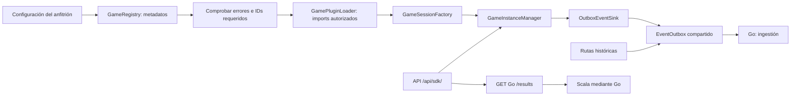

# Fase 3C — bootstrap optativo y API HTTP genérica

Implementado para uso local/de desarrollo. No hay migración de Gato, Snake ni
Circuito, UI SDK, iframe, bridge, autenticación ni autorización de usuarios.
El resultado PASSED de 3B contra Go/Scala es el comunicado por el equipo;
el nuevo humo **HTTP** de esta fase requiere ejecución manual independiente.

## Composición y arranque



`prepareSDK({pluginsDirectory, trustedIds})` es asíncrono. Reutiliza el registro
existente; primero revisa **todos** los rechazos de discovery y la presencia de
todos los IDs confiables. Después carga únicamente esos módulos y valida sus
exports mediante el loader. Discovery sigue sin ejecutar código. Cualquier
paquete inválido/duplicado bloquea este bootstrap; los paquetes siguen aislados
durante discovery, sin cambiar su política de primer válido. Un ID confiable
ausente bloquea todo el arranque. Los paquetes válidos no autorizados pueden
existir, pero no se importan ni aparecen en el catálogo ejecutable.

La preparación es un objeto interno, sin rutas HTTP para configurarlo.
`createApp({sdk, statsURL, statsFetcher, sdkHTTP})` permanece **síncrona**;
conecta esa preparación a un único administrador SDK y al Outbox que ya crea
para las rutas históricas. `statsFetcher` es una inyección del anfitrión para
pruebas; el valor normal es `fetch`. No se crea una segunda cola de transporte.
El Map histórico permanece porque los tres juegos todavía no están migrados.
`app.sdk` es una interfaz interna para el anfitrión, nunca una respuesta HTTP.

El punto de entrada CLI espera `prepareSDKFromEnvironment()` **antes de listen**.
Un fallo muestra únicamente un código saneado y termina con código 1, sin escuchar.
El cierre CLI solicita también el cierre de sesiones SDK antes del flush existente.
Un import autorizado ejecuta código Node con permisos del proceso: la confianza
es una decisión administrativa, no aislamiento ni sandbox.

### Corrección de auditoría: apagado y fallos independientes

`app.sdk.shutdown()` conserva su firma asíncrona: resuelve sin valor si todos los
cierres funcionan. Enumera sesiones y solicita `manager.finish(id, {reason:
'shutdown'})` para cada una. Espera **todos** esos cierres con `Promise.allSettled`.
Si alguno falla, solo entonces rechaza con `SDK_SHUTDOWN_FAILED`, mensaje fijo y
`failures: [{matchId, code}]`. No conserva excepciones crudas, causas ni mensajes
privados. Un fallo de enumeración produce el mismo código agregado con
`failures: [{code:'SDK_ENUMERATION_FAILED'}]`; no inventa cierres no iniciados.

`shutdownApp(app)`, exportada de `server/index.mjs` para uso interno del anfitrión
y pruebas sin señales, solicita los cierres históricos usando el contrato
`exclusive(() => finish('shutdown'))` y el apagado SDK. Espera todos sus resultados;
un cierre histórico fallido tampoco salta el SDK ni el vaciado. En `finally`
intenta siempre `outbox.flush(5000)` y solo después llama `outbox.stop()`, aunque
el vaciado rechace. Devuelve un informe JSON saneado:

```js
{
  closeFailures: [{source: 'sdk', code: 'CLEANUP_FAILED'}],
  delivery: {status: 'flushed'}
}
// Si falla el vaciado:
// delivery: {status: 'failed', code: 'OUTBOX_FLUSH_FAILED'}
```

Los fallos son independientes:

- `CLEANUP_FAILED`: el plugin falló al limpiar. Según el manager existente,
  MATCH_FINISHED puede haber sido aceptado localmente y el snapshot estar
  `finished`. Se vacía igualmente el Outbox; no se revierte ni duplica ese cierre.
- `EVENT_ACCEPTANCE_FAILED` / `EVENT_SINK_UNAVAILABLE`: no se confirmó aceptación
  local. El manager conserva `closing` y el sobre para un reintento explícito
  mientras el transporte siga operativo; no se fabrica otro evento. Si coexistió
  un fallo de limpieza, se mantiene la prioridad y retención de errores del manager
  existente: el rechazo de aceptación es el error comunicado en ese intento.
- `OUTBOX_FLUSH_FAILED`: la entrega de pendientes no quedó confirmada durante
  el plazo. No se registra éxito ni se afirma que todo llegó a Go. Se informa
  separadamente de los fallos de sesión y después se detiene el transporte.

`delivery.status='flushed'` solo acredita que el Outbox terminó de vaciar su
prefijo local aceptado; **no** acredita cierre de todas las partidas, aceptación
de un evento rechazado ni cálculo en Scala. Los fallos históricos se reportan
como `HISTORICAL_CLOSE_FAILED`; otros fallos se reducen a códigos fijos.
El CLI registra los códigos de cierre y entrega por separado, sale con código 1
si hubo alguno, y comparte una sola promesa entre señales repetidas para no
ejecutar vaciados/detenciones concurrentes.

Un cierre que resuelve o rechaza nunca omite flush por su fallo. Un plugin que
**nunca termina** puede retener el apagado antes de llegar al vaciado; no se
introduce timeout ni cancelación ficticia de sesiones. Una terminación forzada,
caída del proceso o nuevas operaciones concurrentes de clientes siguen fuera
de una garantía durable de apagado. No se añade una barrera de admisión HTTP ni
se rediseña el ciclo de vida en esta corrección.

Regresión aislada sin sockets, señales reales ni servicios externos:

```powershell
node --check server/sdk/bootstrap.mjs
node --check server/index.mjs
node --check test/sdk-shutdown.test.mjs
node --test test/sdk-shutdown.test.mjs
```

Configuración optativa (PowerShell, directorio de paquetes revisados por el equipo):

```powershell
$env:GAMECONSOLE_SDK_ENABLED = '1'
$env:GAMECONSOLE_PLUGINS_DIR = 'C:\ruta\plugins-revisados'
$env:GAMECONSOLE_TRUSTED_IDS = 'mi-juego,otro-juego'
$env:GAMESTATS_URL = 'http://127.0.0.1:8080'
node server/index.mjs
```

Sin configuración SDK, o con `ENABLED=0` sin las otras variables, arranca la
consola histórica. Solo se permiten `0` y `1`; activación sin directorio/lista,
IDs repetidos/inseguros/vacíos, o configuración de plugins estando deshabilitado,
fallan. No hay confianza implícita en todos los paquetes descubiertos. Rutas
relativas del directorio se resuelven contra el cwd. No se instala ningún fixture
en `plugins/`. Docker/Compose no se modifican y no instalan paquetes SDK.

## Contrato HTTP

Todas las respuestas SDK son JSON con `Cache-Control: no-store`; se mantienen
los headers de seguridad del servidor. Métodos distintos: 405 con `Allow`.
Rutas inexistentes o query strings no soportadas: 404. No hay paginación.

| Método y ruta | Entrada | Respuesta exitosa |
| --- | --- | --- |
| GET `/api/sdk/catalog` | Ninguna | 200, array de metadatos públicos autorizados |
| POST `/api/sdk/matches` | `{gameId, options?, players?}` | 201, snapshot running con delivery |
| GET `/api/sdk/matches` | Ninguna | 200, array de snapshots con delivery, hasta 500 |
| GET `/api/sdk/matches/:id` | Ninguna | 200, snapshot con delivery |
| POST `/api/sdk/matches/:id/actions` | Sobre exacto de dispatch | Resultado completo, normalmente 200 |
| POST `/api/sdk/matches/:id/finish` | `{reason?}`, o cuerpo vacío | 200, snapshot terminal con delivery |
| GET `/api/sdk/matches/:id/results` | Ninguna | 200, exterior Go con métricas/patrones intactos, o 202 pendiente |

Creación rechaza campos extra. `options` debe ser objeto y `players` array si
aparecen; la fábrica aplica defaults y los contratos declarativos existentes.
Primero `manager.create`, después `activate`: 201 exige aceptación **local** de
MATCH_STARTED y running, sin esperar Go. Los fallos siguen las políticas de la
fábrica/activación: no queda una preparación fallida consumiendo cuota.
Los preparados internos se excluyen del listado y su lectura HTTP devuelve 404.

Snapshot conserva todos los campos públicos del manager: `matchId`, `gameId`,
`gameVersion`, `state`, `version`, `players`, `options`, `startData`, `data`.
Lecturas/creación/cierre añaden `delivery: {pending, delivered, status, error}`:
status es `pending` o `delivered`; error es `null` o `DELIVERY_FAILED`, nunca el
mensaje interno de red. `delivered` significa confirmación observada por Outbox.

Acciones: `{requestId,type,payload,expectedVersion?}` exactamente como 2B.2B.
El router no interpreta type/payload ni añade campos al resultado guardado:
`{outcome,committed,confirmations,snapshot,error?}`. El snapshot de dispatch no
incluye delivery; así un replay devuelve el resultado original incluso después
de otras acciones o cierre. Consultar GET snapshot para entrega actual.
JSON equivalente usa el fingerprint existente de claves ordenadas recursivamente;
arrays conservan orden. Historial FIFO: 128 resultados por partida, sin refresco
de antigüedad por replay; no garantiza idempotencia tras expulsión/reinicio.
Se conserva: validar sobre → deduplicar → comprobar lifecycle/version dentro de
la cola → ejecutar plugin → guardar resultado, incluidos fallos parciales.

`reason` opcional: string no vacío ni solo espacios, hasta 128 caracteres, sin
controles Unicode. El router no construye eventos de cierre. Repetir finish
respeta idempotencia y el estado closing del manager. Una aceptación fallida
de cierre devuelve 503 con snapshot closing; el cierre explícito puede reintentarse.
Si falla limpieza, se informa error 502 con snapshot (que puede estar finished si
el evento ya fue aceptado); nunca se afirma rollback ni se fabrica otro cierre.

## Errores, límites y concurrencia

| HTTP | Situación |
| --- | --- |
| 400 | JSON/contrato/opciones/participantes/motivo inválidos |
| 403 | Origin presente inválido o de otro host |
| 404 | SDK deshabilitado, plugin no autorizado/ausente o partida desconocida |
| 409 | VERSION_CONFLICT, REQUEST_CONFLICT, lifecycle o capacidad de instancias incompatibles |
| 413 | Cuerpo mayor de 16384 bytes UTF-8 |
| 429 | Límite de instancias o admisión HTTP pendiente |
| 502 | Interfaz/ejecución de preparación, limpieza u otro fallo SDK; respuesta analítica inválida o fallo reportado por Go |
| 503 | Inicio/evento no aceptado localmente, conexión analítica o servicio no configurado |
| 504 | Timeout analítico |

Errores de infraestructura usan `{error:{code,message}, snapshot?}` con mensajes
fijos. Un fallo inesperado de infraestructura dispatch usa `RESULT_UNKNOWN` y
requiere consulta/reintento cuidadoso; no dice que no hubo confirmación.
Rechazos previos de dispatch mantienen su resultado completo con 400/404/409.
Un rechazo semántico del plugin y cualquier `dependency_failed` procesado retornan
200 con **todo** el resultado, también con committed=true. No ocultar estado parcial.
Mensajes privados, stack traces y diagnósticos de archivos no se publican.

Cuerpos POST requieren `application/json` (salvo finish vacío). El lector cuenta
bytes, rechaza UTF-8 inválido y drena cuerpos excesivos para responder 413.
No se admiten datos ejecutables. Los límites JSON profundos y demás validaciones
son los existentes del SDK, sin modificarlos.

Admisión sencilla: 64 handlers SDK pendientes por aplicación, configurable por
el anfitrión con `sdkHTTP.maxPending` entre 1 y 256. Incluye lectura de cuerpo,
espera en manager y consultas analíticas; al saturar devuelve 429 sin ejecutar.
No hay segunda cola HTTP. La cola del manager serializa por partida, manteniendo
progreso independiente entre partidas. GET listado puede esperar una partida
ocupada, pero no bloquea otros handlers. El SDK conserva cuota de 500 partidas
incluyendo terminadas; el Map histórico conserva su propia cuota de 500 durante
esta coexistencia. No hay nueva cuota global combinada ni rate limiting por usuario.

No se instala timeout de ejecución ni se cancela una transición al desconectarse
el cliente. Si el cliente deja de esperar, el resultado es **desconocido para él**;
la operación puede completar y su requestId queda guardado. Consultar snapshot y
reutilizar el mismo requestId/contenido dentro de la ventana, sin prometer rollback.
Un cliente desconectado no puede recibir una respuesta adicional del servidor.
La comprobación de Origin conserva la protección local histórica: **no autentica
ni autoriza usuarios**. La titularidad/permisos deberán resolverse antes de exponer
esta API fuera de un entorno local confiable.

## Resultados: prefijo local y servicio remoto

El gameId procede exclusivamente del snapshot del manager. Go URL es fija al
arranque; se valida HTTP(S), sin credenciales/query/fragmento. No se siguen
redirecciones en consultas de resultados. Se consulta GET
`/results/{gameId}/{matchId}` con segmentos codificados, nunca paths del cliente.
El timeout de 12 segundos afecta solo a esa consulta, no a acciones.

Si hay pendientes locales: 202 `{status:'pending',code:'DELIVERY_PENDING',snapshot}`
sin llamar Go. Tras obtener resultados se vuelve a consultar snapshot y entrega;
si cambió versión, lifecycle o cantidad entregada, o hay pendientes, responde
202 (`RESULTS_CHANGED` o `DELIVERY_PENDING`) sin métricas. El cliente puede repetir GET.
Esto reduce respuestas obsoletas ante concurrencia; no es una transacción entre
la lectura de Outbox, Node, Go y Scala ni impide cambios después de responder.

Sin cambios, se exige exterior Go coherente (`gameId`, `matchId`, `state`,
arrays `metrics`, `patterns`), se eliminan extras exteriores y se conservan
íntegros los elementos analíticos. Se rechaza JSON inválido y texto mayor de 8 MiB
tras leerlo; no es un límite de memoria de lectura streaming. No se calculan
métricas en JS ni se sustituyen fallos por arrays vacíos. Go 404/503/504 conserva
su estado; otros errores remotos se presentan como 502, conexión como 503.
La semántica de perfiles y resultados corresponde a Go/Scala.

La aceptación local de Outbox es en memoria, completa por lote y síncrona;
no es persistencia, recepción Go ni cálculo Scala. Sus reintentos/409 siguen
sin cambios. Una red ambigua puede haber aceptado un evento en Go antes de
perder la respuesta; el Outbox conserva la comprobación por eventId. No existe
exactamente una entrega ni recuperación tras perder memoria. Límites remotos
(10000 eventos/8 MiB por partida en Go) siguen pudiendo bloquear la entrega.

## Verificación

Ejecutar desde la raíz, sin servicios externos:

```powershell
node --check server/index.mjs
node --check server/sdk/bootstrap.mjs
node --check server/sdk/http-api.mjs
node --check scripts/sdk-http-smoke.mjs
node --test test/sdk-v1.test.mjs test/sdk-runtime.test.mjs test/sdk-lifecycle.test.mjs test/sdk-transitions.test.mjs test/sdk-actions.test.mjs test/sdk-outbox.test.mjs test/sdk-http.test.mjs test/http.test.mjs test/outbox.test.mjs
git diff --check
```

HTTP usa únicamente servidor loopback efímero dentro de node:test; transporte
Go simulado mediante fetcher, EventOutbox real, paquetes temporales fuera de
producción. Las suites históricas no se reemplazan ni se editan. En sandbox que
bloquee loopback, se necesita permiso para las mismas pruebas efímeras.

Humo **manual opcional**, con Go/Scala previamente levantados por el equipo:

```powershell
node scripts/sdk-http-smoke.mjs --go-url http://127.0.0.1:8080 --timeout-ms 15000
```

Comprueba health y dashboard Go→Scala antes de crear una partida. Solo entonces
inicia una consola temporal en loopback/puerto efímero, usando el fixture racing
de tests mediante bootstrap explícito; no copia paquetes a producción ni inicia
Go/Scala/Docker. Recorre catálogo, creación, snapshot, resultados open sin vueltas,
acción COMPLETE_LAP, resultados open con 1234 ms, replay sin evento adicional,
cierre y resultados closed. Comprueba métricas reales `laps.match`, `laps.player`,
`lap_time.total.player`, `lap_time.avg.player`, `duration.match`, unidades, estados,
fuentes y basis.eventCount. Cierra servidor temporal y Outbox en finally.

Solo `PASSED` y salida 0 acredita el recorrido HTTP real. Un 202 después de flush,
timeout, métrica/identidad/estado/conteo incorrecto o fallo remoto hace fallar el
script. Cada ejecución crea un UUID nuevo y datos de prueba en Go. Una ejecución
fallida puede dejar una partida remota abierta: se informa su UUID, sin afirmar
rollback. Este script se prepara y revisa sintácticamente; **no se ejecuta de
forma automática ni se declara verificada aquí la integración HTTP real**.

Pendiente: autorización/titularidad, migración incremental de juegos, web/iframe,
gestión durable, políticas de limpieza de historial e instancias y adaptación
de deployment. Ninguno de esos trabajos se incorpora a esta fase.
