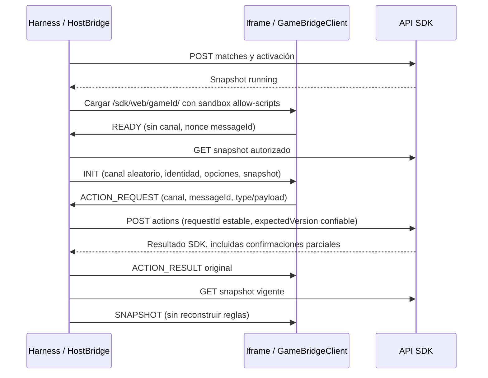

# Fase 3E.1 — recursos web y GameConsole Bridge v1

Actualización posterior: [3H](phase-3h-game-experience.md) añade el mensaje
host → juego PRESENTATION y observación defensiva de presentación, manteniendo
la versión 1, validación de canal/origen/source, CSP y sandbox.

Infraestructura implementada para abrir páginas de plugins confiables en iframe,
vincularlas con una partida SDK y comunicar datos JSON. Los tres HTML solo
muestran conexión, gameId, matchId, state y version. **No son interfaces jugables**;
no se añaden tableros, controles de juego, estadísticas ni dashboard definitivo.

## Componentes y flujo



- `server/sdk/web-assets.mjs`: lectura estática acotada a árboles web autorizados.
- `public/sdk/bridge/host-bridge.mjs`: clase HostBridge; asociación por iframe,
  HTTP SDK, correlación, replay acotado y lifecycle de canales.
- `public/sdk/bridge/game-client.mjs`: createGameBridgeClient, fachada pública
  del videojuego; no conoce rutas de la API ni importa Node o el manager.
- `public/sdk/bridge/protocol.mjs`: schema, JSON defensivo, límites y canonicalización
  compartidos por las dos partes. Es código web público, no código privado del host.
- `public/sdk/bridge-demo.html` y harness.mjs: demostración separada de app.mjs.
- `plugin-status.mjs`: demostración genérica reutilizada por los tres HTML.

PreparedSDK conserva una copia de los metadatos registrados de los IDs autorizados
y expone webPackage(id) solo al anfitrión. No cambia publicCatalog ni entrega
paths por HTTP. El handler estático no llama al loader, discovery ni import().
El bootstrap conserva su carga explícita previa de módulos Node confiables;
servir un recurso no vuelve a importarlos ni crea sesiones.

## Rutas y recursos estáticos

GET/HEAD `/sdk/web/:gameId/` sirve el entrypoint HTML registrado. Las rutas
`/sdk/web/:gameId/:asset` son relativas al directorio que contiene el entrypoint,
independientes del nombre de carpeta del paquete. Solo SDK habilitado y trustedIds
preparados; desconocidos, no autorizados y deshabilitado devuelven 404.
Otros métodos: 405 y Allow: GET, HEAD. Fallos tienen mensajes fijos, sin paths.

Se inspecciona req.url **antes** de normalizar con URL, rechazando `%`, query,
fragmentos, backslash, espacios/controles, segmentos vacíos, dotfiles, traversal,
rutas absolutas y nombres de dispositivo Windows. Segmentos ASCII de hasta
128 caracteres, sin punto final; no se admiten server/prolog/analytics/node_modules.
Los navegadores pueden normalizar traversal antes de enviarlo: las pruebas usan
también HTTP con paths crudos para verificar el límite del servidor.

Se requiere un árbol web separado de la raíz del paquete y sin el entrypoint de
servidor ni el perfil analítico dentro. Esto evita publicar módulos privados de
paquetes que sitúan index.html junto al servidor. Esos manifiestos siguen siendo
válidos y ejecutables en el SDK, pero sus recursos web devuelven 404 hasta separar
su árbol público. Los tres paquetes productivos ya satisfacen esta condición.

realpath y path.relative comprueban límites por segmentos para raíz y archivo.
Un enlace a servidor/analytics u otro árbol externo se rechaza, aunque permanezca
dentro del paquete. Se exige archivo regular antes de abrir y después con fstat;
se usa O_NOFOLLOW cuando está disponible. No se sirven directorios o archivos
especiales. Límite: **1 MiB por archivo**, incluida lectura efectiva; exceso 413.
No se publica el catálogo físico. Los paquetes autorizados deben permanecer
estables: las comprobaciones no son un sandbox frente a sustituciones concurrentes
de directorios intermedios por un administrador con escritura en el despliegue.

Whitelist: html, mjs, js, css, svg, png, jpg/jpeg, webp y woff2, con MIME explícito,
nosniff, Content-Length y Cache-Control no-store. Sin JSON, perfiles, .env o mapas
de fuentes. HEAD aplica las mismas restricciones/tamaño pero omite el cuerpo.

Los módulos públicos estables están bajo `/sdk/bridge/`, con nombres explícitamente
permitidos. Están disponibles aun con SDK apagado; no contienen datos de partidas.
Las páginas de plugins sí requieren SDK habilitado y confianza configurada.

## CSP, CORS y sandbox

La consola y el harness conservan frame-ancestors 'none', script-src/style-src
'self', sin unsafe-inline/eval. Los HTML del host añaden frame-src 'self'. La
política de la API no se relaja ni obtiene CORS.

El plugin recibe default-src 'none', frame-ancestors 'self', script-src limitado
al árbol web de ese ID y `/sdk/bridge/` en el origen público HTTP(S) del host; style/img/font
solo al árbol web (además data: para imágenes), connect-src/frame-src/object-src
'none', base-uri/form-action 'none'. Se usan fuentes URL explícitas para que el
origen opaco no dependa de la interpretación de 'self' para scripts.

### Origen público y terminación HTTPS

`createApp({publicOrigin})` admite un origen público explícito. En el arranque
CLI su valor predeterminado es `GAMECONSOLE_PUBLIC_ORIGIN`, por ejemplo:

```powershell
$env:GAMECONSOLE_PUBLIC_ORIGIN = 'https://console.example'
```

La configuración se valida al construir la aplicación: string igual al origen
canónico devuelto por URL, solo HTTP/HTTPS, autoridad ASCII DNS/IP, sin usuario,
contraseña, ruta, slash final, query, fragmento ni espacios. Puertos predeterminados
explícitos que URL normalizaría (p. ej. :443) se rechazan; usar la forma canónica.
Una configuración inválida falla con INVALID_CONFIGURATION y un mensaje fijo.
No contiene rutas ni se obtiene de peticiones HTTP.

Cuando está configurado, ese origen fija todas las fuentes CSP de los plugins,
incluido HTTPS cuando TLS termina en un reverse proxy y Node recibe HTTP interno.
Sin configuración, se usa Host validado y el esquema de la conexión real:
socket.encrypted determina HTTPS; en HTTP loopback se conserva http://host:puerto.
Forwarded, X-Forwarded-Proto y X-Forwarded-Host se ignoran siempre. No se añade
una opción de confianza genérica en proxies ni una heurística basada en cliente.
El operador debe configurar el origen externo correcto; esta opción no añade
TLS, certificados ni valida la configuración del proxy. El resto de CSP/CORS,
sandbox y rutas históricas permanece igual.

HostBridge.mount crea exactamente `sandbox="allow-scripts"` y referrerpolicy
no-referrer. attach rechaza permisos sandbox distintos. No se concede
allow-same-origin, top-navigation ni popups. No hay credenciales en URLs o
atributos HTML. El origen de mensajes juego→host debe ser "null", **más** la
WindowProxy exacta del iframe registrado, schema y canal; "null" por sí solo
no autentica nada.

ESM desde origen opaco necesita CORS. Solo los recursos públicos estáticos de
estos dos namespaces incluyen Access-Control-Allow-Origin: * y CORP cross-origin,
sin Allow-Credentials. No se añade CORS de acciones o snapshots. El host envía a
contentWindow con targetOrigin '*' porque el receptor es opaco, exclusivamente
esa ventana y datos públicos de partida, nunca secretos de servidor.
El cliente verifica event.source===parent y el **origen real HTTP(S) del padre**;
por defecto procede de la URL del módulo público que lo sirve.

La protección no es autenticación/titularidad de usuarios ni aislamiento de
plugins Node: estos continúan siendo código confiable con permisos del proceso.
Tampoco es una garantía completa de ausencia de egreso de datos: el sandbox limita
navegación superior/popups y CSP conexiones/formularios/subframes, pero la navegación
propia del iframe y otros comportamientos de cada navegador requieren considerar
el modelo de amenaza. No se promete aislamiento de recursos/CPU del navegador.

## Esquema exacto de mensajes v1

Campos obligatorios: protocol='gameconsole.bridge', version=1, type, messageId,
payload y channelId; **READY omite channelId y lo rechaza si aparece**. No hay
campos extra. JSON finito sin funciones, getters, ciclos, huecos, símbolos ni
prototipos especiales; profundidad máxima 64. Máximo 65536 bytes UTF-8 por mensaje.
messageId: `[A-Za-z0-9][A-Za-z0-9_-]{0,63}`. Canal: 32 caracteres hexadecimales,
128 bits de crypto.getRandomValues, distinto por vinculación.

| Dirección / tipo | payload exacto |
| --- | --- |
| Juego → READY | `{}`; messageId es nonce de esta instancia del cliente |
| Juego → ACTION_REQUEST | `{action:{type,payload}}`; type cumple SDK uppercase, payload objeto JSON, action hasta 8192 bytes |
| Juego → SNAPSHOT_REQUEST | `{}` |
| Host → INIT | `{gameId,matchId,options,snapshot}`; identidad/opciones coinciden con snapshot |
| Host → ACTION_RESULT | Resultado SDK `{outcome,committed,confirmations,snapshot,error?}` |
| Host → SNAPSHOT | Snapshot público SDK vigente |
| Host → ERROR | `{code,message,unknown?}` saneado; unknown boolean |
| Host → DETACH | `{reason:'disposed'|'reloaded'|'removed'}` |

Snapshot admite exactamente los campos públicos SDK de identidad, versión,
lifecycle, players/options/startData/data y delivery opcional. No incluye rutas
o handles. Los errores SDK dentro de ACTION_RESULT proceden del contrato saneado
de la API; errores de red/protocolo Bridge usan mensajes fijos. Mensajes inválidos,
origen/fuente/canal incorrectos no ejecutan HTTP; se informan por onStatus interno
sin reflejar datos arbitrarios al emisor. INIT se correlaciona con el READY vigente.

## Canales, recarga y desmontaje

HostBridge permite hasta 32 iframes por objeto; no hay variable global de partida.
Estados conceptuales: attached/cargando → READY/lectura inicial → initialized;
un fallo de lectura inicial queda sin canal y puede repetirse ready(). Solo se
acepta READY tras observar la carga inicial. Los READY anteriores se descartan;
ya no existe waitingReady ni un buzón que pueda cruzar cargas. El cliente conserva
sus anuncios al inicializar y en su evento load; ready() permite reiterarlo si
la integración necesita anunciar disponibilidad después de la carga del padre.
Mientras se procesa un READY o existe canal, cualquier READY duplicado o distinto
se ignora: no rota canal, no reenvía INIT ni reserva el nonce de otra generación.

**Una carga posterior, sea recarga o navegación a otro documento, revoca la
asociación y no reconecta automáticamente.** Se elimina el registro/listener de
ese iframe, se invalida la generación, historial y canal, y onStatus informa
NAVIGATION_REQUIRES_REMOUNT. No se envía INIT ni DETACH con el token antiguo al
documento de reemplazo. Los READY y acciones de esa WindowProxy retirada se
ignoran. No se permite volver a attach del mismo elemento en el mismo HostBridge;
el elemento queda retirado mediante WeakSet, sin retenerlo fuertemente.

El anfitrión debe unmount del elemento antiguo y mount de uno **nuevo**, usando
un snapshot autorizado recién consultado. Cada nueva asociación verifica de
nuevo identidad por API y obtiene un canal aleatorio nuevo; no hereda opciones,
resultados ni tokens del registro anterior. attach(...,{loaded:true}) es una
afirmación explícita del anfitrión sobre la carga inicial; no autentica documentos
y no es una vía de reconexión para elementos retirados. mount es la vía recomendada.

Respuestas HTTP tardías de registros revocados no publican INIT/snapshots/resultados
en el documento nuevo. Una operación ya iniciada puede completar en el SDK, sin
rollback. Al remontar, consultar snapshot antes de decidir otra acción; no existe
replay Bridge entre canales nuevos.

Esta mitigación empieza cuando el anfitrión **observa load**. No puede detectar
por WindowProxy/origin=null el inicio o commit de una navegación, ni distinguir
documentos que comparten esa WindowProxy. No garantiza impedir mensajes en tránsito
o entregas anteriores a ese evento; tampoco impide por sí sola la navegación
maliciosa. El nonce READY correlaciona una solicitud, no autentica el documento.
Se conservan páginas web confiables/revisadas, sin secretos de servidor en INIT.
Una garantía más fuerte de identidad de documento/origen requiere otro diseño
y revisión; no se afirma aquí mediante origin=null, tokens ni sandbox.

detach invalida protocolo sin terminar la partida. unmount además quita el
elemento. Un MutationObserver detecta retirada externa del DOM; también se
comprueba isConnected antes de enviar/recibir. dispose libera listeners del host.
Cada cliente dispose libera sus propios listeners/suscriptores y rechaza pendientes.
DETACH disposed/removed también libera esos listeners. El motivo reloaded sigue
siendo válido en el protocolo por compatibilidad, pero el host ya no lo envía a
una ventana navegada ni lo utiliza para abrir otro canal automáticamente.
Desmontar uno no termina ni desconecta los otros. Un único cliente por documento;
no se sustituye por otro cliente sobre un canal activo; navegar exige montaje
explícito de un iframe nuevo por el anfitrión.

## Dispatch, idempotencia y resincronización

El iframe nunca suministra partida, juego, jugador, eventId, expectedVersion ni
ruta HTTP. HostBridge construye requestId=`bridge:<channelId>:<messageId>`
(máximo 104 caracteres) y expectedVersion del snapshot confiable observado.
No interpreta acciones por gameId. Solo el plugin define reglas/type/payload.

Una acción HTTP en vuelo por canal; otra nueva recibe BRIDGE_BUSY, sin encolarse.
Un SNAPSHOT_REQUEST simultáneo tiene un límite separado de una lectura. No hay
bloqueo global entre iframes ni otra cola de ejecución. El cliente limita a cuatro
solicitudes pendientes (incluidas lecturas). No se añade timeout/cancelación
ficticia a acciones; al desmontar se desconoce si una operación pendiente confirmó.

El mismo messageId y acción JSON equivalente (claves ordenadas recursivamente,
orden de arrays significativo) comparte operación pendiente o recupera el resultado
original. Contenido diferente: MESSAGE_CONFLICT. ACTION_RESULT puede contener
snapshot antiguo por replay: se conserva el resultado, pero no se usa para
reemplazar automáticamente un snapshot más reciente de la UI.

Historial por canal: 128 solicitudes de acción FIFO, incluidos resultados
desconocidos. Un replay no renueva antigüedad; una entrada pendiente no se expulsa
antes de completarse. No se promete replay tras expulsión/recarga/reinicio.
El requestId derivado sigue siendo estable mientras el canal/messageId sean
iguales; el historial independiente del SDK mantiene sus propios límites.
Los IDs de lecturas correlacionan respuestas vigentes, no snapshots almacenados.

completed, rejected y dependency_failed son resultados válidos, incluso con
committed=true tras fallo parcial. VERSION_CONFLICT no se reintenta cambiando
expectedVersion: se devuelve íntegro y se consulta snapshot antes de admitir otra
acción. Después de cada resultado se publica una lectura vigente. Los snapshots
observados solo se adoptan si no retroceden su versión.

Fallo HTTP sin resultado SDK válido: RESULT_UNKNOWN, unknown=true. El host no
reintenta automáticamente ni genera otro ID, intenta leer snapshot y bloquea
nuevas acciones con RESYNC_REQUIRED si esa lectura falla. El consumidor puede
solicitar snapshot y reintentar manualmente el **mismo** messageId/contenido;
se reenvía exactamente el sobre SDK original, incluido expectedVersion.
Un mensaje/resultante demasiado grande no se divide; se informa
BRIDGE_MESSAGE_TOO_LARGE con error correlacionado si el canal ya está abierto.
Si era el resultado de una acción, unknown=true: puede haber confirmado aunque
no se pueda recibir su snapshot completo por Bridge. Un INIT excesivo no abre
canal y se informa por onStatus. El límite del Bridge no amplía los límites
JSON/HTTP del SDK.

## API web y ejemplos

```js
import { createGameBridgeClient } from '/sdk/bridge/game-client.mjs';
const bridge = createGameBridgeClient();
const off = bridge.onSnapshot(snapshot => render(snapshot));
bridge.onInit(({gameId,matchId,options}) => showIdentity(gameId,matchId,options));
bridge.onResult(result => showOutcome(result));
bridge.onError(({code,unknown,messageId}) => showError(code,unknown,messageId));
bridge.onDetach(() => showDisconnected());
// Cuando INIT haya llegado, una futura interfaz puede llamar:
await bridge.dispatch('PLUGIN_ACTION', {value:1}, {messageId:'user-operation-1'});
await bridge.requestSnapshot();
off(); bridge.dispose();
```

dispatch resuelve con el resultado SDK incluso rejected/dependency_failed; ERROR
de transporte/protocolo rechaza BridgeError saneado con code/unknown. getIdentity
y getSnapshot devuelven copias; onInit/onSnapshot entregan también el valor actual
a suscriptores tardíos. Todos los on* devuelven unsubscribe. Cada callback recibe
su propia copia, y un observador que lanza/muta no afecta a los demás.

Ejemplos de llamadas futuras, sin reglas en el host: Gato
dispatch('PLACE_MARK',{index:0}); Snake dispatch('TICK',{direction:'up'});
Circuito dispatch('STEP',{lane:2,accelerate:true,brake:false}). Esos controles
no se añaden a los HTML de esta fase. Nunca se emiten eventos GameStats desde
el navegador. Las estadísticas quedan para la fachada visual de 3E.3.

## Verificación y prueba manual

Suites: sdk-web-assets, sdk-bridge-protocol, sdk-bridge-host y sdk-bridge-client,
Node con ventanas/fetch inyectados y HTTP loopback efímero. Verifican esquemas,
confianza, límites/rutas/links, CSP/CORS, recarga, fuentes/canales falsos, replay,
conflictos, fallos desconocidos, snapshots, FIFO, tres canales y unsubscribe.
Las regresiones anteriores SDK/HTTP/Outbox se ejecutan sin las suites que usan
Prolog real. Los contadores finales se informan en la entrega.

La verificación anterior a esta corrección pasó **192/192** pruebas, incluidas **25 nuevas** de
Bridge/recursos, sin fallos ni omisiones. Se verificó el enlace externo mediante
junction en Windows. Los archivos nuevos/modificados ESM se revisan con node --check.

La corrección de auditoría añade cinco regresiones: READY antiguo intercalado
con una navegación y remonte con otra identidad; lectura inicial pendiente que
no puede publicar INIT tras navegar; CSP de origen público HTTPS con cabeceras
de proxy falsificadas; HTTP loopback sin confianza en esas cabeceras; socket TLS
y configuración de origen estricta. Se actualizan las pruebas de carga inicial
y recarga para exigir remonte explícito y no reenvío de INIT. Las cantidades
actuales son **197/197** en la regresión combinada y **30/30** en las cuatro suites
Bridge/recursos, sin fallos ni omisiones. Las pruebas TLS/proxy simulan conexión o
configuración para inspeccionar CSP, no levantan un proxy ni certificados reales.

```powershell
node --test test/sdk-web-assets.test.mjs test/sdk-bridge-protocol.test.mjs test/sdk-bridge-host.test.mjs test/sdk-bridge-client.test.mjs
git diff --check
```

Comprobación real realizada en el navegador integrado de Codex, usando una consola
temporal local con transporte Go simulado: los tres HTML cargaron ESM bajo la CSP
y sandbox indicados, mostraron Conectado/identidad/running/version=0, y desmontar
y volver a montar Snake mantuvo conectados Circuito y Gato. No se despacharon
acciones Gato ni se ejecutó Prolog/Go/Scala. Esa prueba detectó y corrigió el
receptor de Window.fetch; existe regresión específica. La demo se cerró después.
No acredita todos los navegadores ni prueba entrega analítica real en esta fase.

Para repetir sin servicios externos:

```powershell
node scripts/sdk-bridge-demo.mjs
```

Abrir la URL local impresa. La demo termina a los cinco minutos o con Ctrl+C;
también se cierra visitando `/api/health?bridge-demo-stop=1` en **esa demo**, no
en el servidor normal. Solo simula aceptación de eventos, sin métricas reales.
Seleccionar cada plugin y Crear y montar. Comprobar tres matchId distintos,
running/version=0 y registros attached/initialized. Pulsar Desmontar Snake:
desaparece solo ese iframe, su partida sigue activa; Montar de nuevo recupera
la misma identidad mediante un canal nuevo. Finalizar permite liberar la plaza
del tipo sin enviar acciones de videojuego. No hay botones de juego.

Para el servidor normal, habilitar GAMECONSOLE_SDK_ENABLED=1, directorio plugins
y trustedIds explícitos como en 3C; abrir `/sdk/bridge-demo.html`. Inspeccionar
DevTools: sandbox exacto, módulos sin errores CSP/CORS, Origin null desde iframe,
READY/INIT y snapshots correctos, no canales en URLs/atributos y API sin CORS.
Probar recarga o navegación del frame desde DevTools: el canal viejo debe dejar
de funcionar, debe aparecer NAVIGATION_REQUIRES_REMOUNT en el host y READY del
documento nuevo no debe recibir INIT. Pulsar Montar de nuevo: crea otro elemento
y restablece solo esa asociación. Repetir detrás del proxy HTTPS objetivo con
GAMECONSOLE_PUBLIC_ORIGIN configurado y comprobar que las fuentes usan HTTPS,
sin mixed content ni dependencia de Forwarded/X-Forwarded-Proto.
Repetir en los navegadores objetivo y revisar navegación/bloqueos antes de publicar.
La comprobación de navegador descrita antes corresponde a la implementación
previa; esta corrección se verifica con Node/ventanas simuladas. La nueva política
de navegación y el despliegue HTTPS real quedan pendientes de esa repetición manual.

Pendiente 3E.2: UI jugable, controles y ciclo visual de cada plugin. Pendiente
3E.3: dashboard/resultados en el host. Siguen pendientes autenticación/titularidad,
despliegue web, persistencia y modelo de plugins de terceros. No se cambian
manifiestos, perfiles, reglas/sesiones, coordinador SDK, Outbox ni GameStats.
